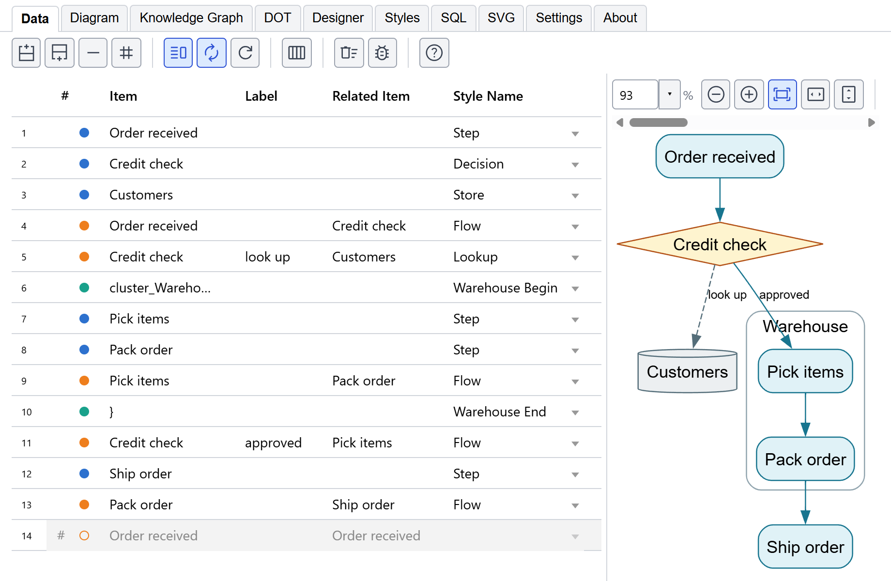

I've been working on a second tool, and I want you to hear about it from me before you stumble across it.

**[Graph Modeler](https://graphmodeler.com/)** is a new standalone desktop application that grew out of Relationship Visualizer. You still describe a graph as rows of data, give the rows styles, and let Graphviz draw it, but there is no workbook and no Excel. It runs on Windows, macOS and Linux.

|   |
|---|
| |
|   |

**Relationship Visualizer is not going away.** It remains free, open source, and MIT-licensed, and I'll continue maintaining it. But Graph Modeler is where new development is happening. It's the more capable tool, and where I'll be spending most of my time going forward.

If you're happy with Relationship Visualizer, you can keep using it exactly as you do today. If you've been bumping into its limits, Graph Modeler was built to move beyond them.

## The money part, up front

You're used to a free, MIT-licensed tool, so here is how Graph Modeler is different. It is **free for personal, educational, research and other non-commercial use**. If you use it for work, it needs a commercial license, which is **US$99, paid once**, with a 30-day refund. The [License page](https://graphmodeler.com/license/) says in plain words what counts as commercial.

I'm asking for that because I enjoy building this software and want to keep doing it. The license helps cover the costs of running the project, such as domain names, the certificate that signs the Windows installer, a business mailbox, and machines to test on, but mostly it buys the time needed to keep improving the software.

Relationship Visualizer has been free for more than ten years and stays that way.

## Why a second tool?

Excel was a good place to start, but it also shaped the tool in ways I couldn't change from inside it.

| Excel limitation | How Graph Modeler addresses it |
|------------------|--------------------------------|
| **Mac features unavailable in Excel** | Relationship Visualizer runs on Excel for Mac, but some capabilities are simply unavailable. It cannot run SQL queries, place arbitrary text on the clipboard, enumerate installed fonts for the Style Designer, or invoke Graphviz directly without going through `AppleScriptTask`, which adds overhead and complexity. Graph Modeler supports all of these features natively on macOS. |
| **No Linux version of Excel** | Linux users could not use Relationship Visualizer at all. Graph Modeler runs on Linux as well as Windows and macOS, and has been tested on Zorin OS and Q4OS. |
| **Macro restrictions in many organizations** | Relationship Visualizer is a macro-enabled workbook, and many organizations block or heavily restrict VBA macros. For some users, the tool never made it past IT policy. Graph Modeler is a standard desktop application with no macros and no Excel security settings to adjust. |
| **Limited query sources** | From Excel, queries can run only against Excel workbooks and Access databases. Graph Modeler can also query LibreOffice `.ods` files, CSV and TSV files, and SQLite databases, so your data does not need to live in Excel. |
| **Undo history is lost when macros run** | Excel clears its undo history whenever a macro executes, making reliable undo impossible inside the workbook. Graph Modeler includes a full undo and redo system. |
| **Models are tied to workbooks** | Graph Modeler stores projects as readable JSON files that can be version-controlled, compared, generated, and processed with other tools. |
| **No application-level dark theme** | Graph Modeler includes both light and dark themes for people who prefer dark-mode applications during long working sessions or late nights. |

None of these limitations were Excel's fault. They simply marked the point where the project needed its own application.

## What carries over

If you know Relationship Visualizer, most of Graph Modeler will feel familiar:

- **The rows and the styles.** The same columns, the same style system, and the same rules for what makes a row a node, edge, or cluster.
- **SQL.** Most queries run unchanged. Excel workbooks and Access databases remain supported, alongside the additional sources Graph Modeler can read.
- **The Knowledge Graph.** Both tools write the same [RV-KGF format](https://github.com/jjlong150/rv-kgf) from the same data.
- **Your exchange files.** `.json` files exported from the Exchange tab open directly in Graph Modeler. Compatibility is one-way: Graph Modeler can read them but does not write them.

The page [Coming from the Excel tool](https://graphmodeler.com/docs/from-excel/) lists what is the same, what is different and what I left out on purpose.

## Try it

Downloads for Windows, macOS, and Linux are available on the [Download page](https://graphmodeler.com/download/), along with checksums and installation instructions. The [Getting started](https://graphmodeler.com/docs/getting-started/) guide will have you building your first graph in a few minutes.

Graph Modeler is still a young program, and I'm looking forward to hearing what you build with it. If you're familiar with Relationship Visualizer and notice anything that behaves differently, please drop me a note at support@graphmodeler.com.

<Comments />
